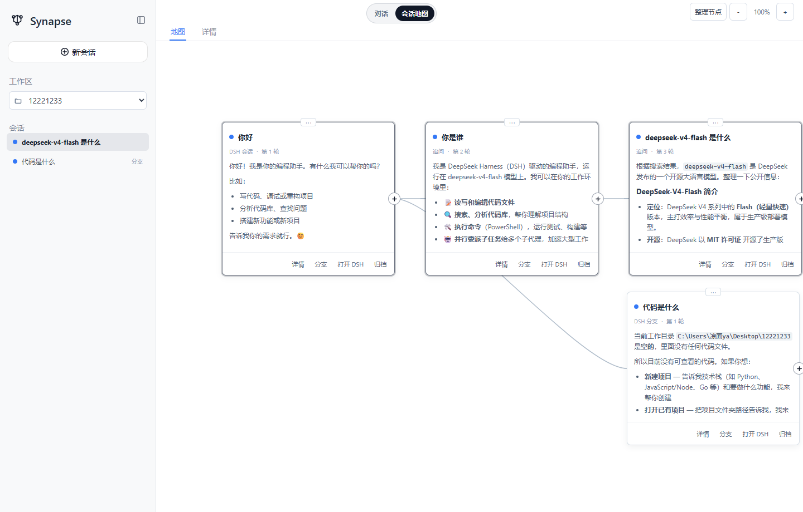
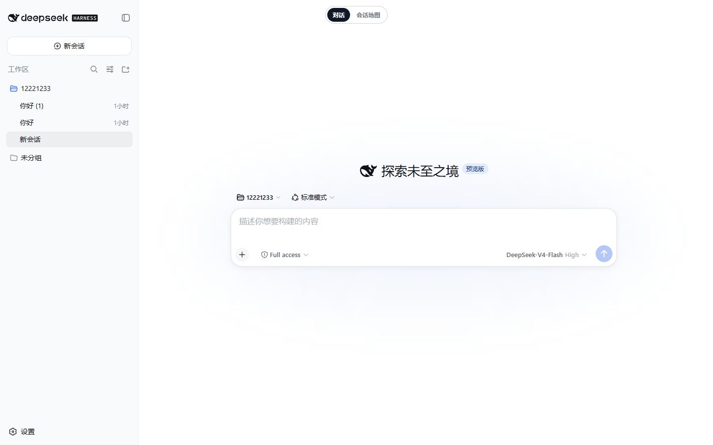

# 非线性对话地图


**非线性对话地图 · 1.3.2**

发布名称：非线性对话地图。兼容包标识：`dsh-synapse`。本版本基于已验证的 `0.4.1+dsh-local.3.2`，只更新发布名称和版本元信息，功能及界面保持原样。

本归档为本机插件的源码快照，未包含上游测试目录、锁文件或 GitHub Actions；下方旧版开发指南中的完整仓库流程不适用于此快照。此次未发布 npm 包，npm 安装命令不能用于获取本次 GitHub 版本。

把同一工作区中的会话、追问和分支组织成可浏览、可拖拽、可缩放的对话地图，同时保留 DSH 原生的会话能力。

[中文指南](docs/zh-CN/README.md) · [English guide](docs/en/README.md) · [Development](docs/development.md) · [Architecture](docs/architecture.md)



## Overview

`dsh-synapse` adds a visual session map to the native DeepSeek Harness Web interface. It projects committed DSH conversations into connected cards, keeps forks attached to their real branching turns, and synchronizes the current session between the map and native chat.

Synapse is an interface layer, not a second conversation system. DSH continues to own sessions, model requests, tools, permissions, and the Web server.

## Features

| | Feature | 功能 |
|---|---|---|
| 🗺️ | Browse sessions and turns as a connected canvas | 将会话和追问显示为连线画布 |
| 🌿 | Preserve native DSH fork lineage | 按真实分叉点显示 DSH 分支 |
| 📁 | Group sessions by DSH workspace and directory | 按工作区和目录组织会话 |
| 📥 | Project committed and streaming replies into cards | 将已提交和流式回复投影到卡片 |
| 🔧 | Fold tool calls and results into assistant replies | 将工具调用和结果折叠到助手回答 |
| ⚡ | Synchronize the active session with native chat | 与 DSH 原生对话双向同步当前会话 |
| 🎨 | Pan, zoom, drag, fold descendant subtrees, focus, and persist card positions | 支持平移、缩放、拖动、展开/折叠后续子树、定位和位置保存 |



## Quick start

Requirements: DeepSeek Harness with the profile plugin mechanism, Node.js `>= 22.19.0`, and the `web` profile.

```powershell
corepack pnpm dsh plugin --profile web add dsh-synapse
corepack pnpm dsh web
```

在 DSH 对话界面中，焦点离开文本输入框后按 **M** 切换对话与地图。实体切换按钮已移除。实际服务地址由 DSH 配置决定。

> [!NOTE]
> Synapse extends the existing DSH Web profile. It does not start a second application server. The npm package needs no build permission; Git and local-checkout installs are documented in the installation guide.

## Documentation

| Document | Description |
|---|---|
| [中文指南](docs/zh-CN/README.md) | 安装、启动、配置、使用、卸载和已知限制 |
| [English guide](docs/en/README.md) | Installation, configuration, usage, cleanup, and limitations |
| [Development and releases](docs/development.md) | Local validation, GitHub Actions, version tags, and npm publishing |
| [Architecture and boundaries](docs/architecture.md) | Session ownership, projection, storage, model impact, and operational limits |

## Development

```powershell
corepack pnpm install --frozen-lockfile
corepack pnpm run build
corepack pnpm test
```

See the [development and release guide](docs/development.md) for CI/CD and npm publication details.

## Runtime boundaries

- DSH session logs remain the source of truth for conversation content.
- Synapse stores canvas metadata separately under `$DSH_HOME/synapse/`.
- Projected card text is capped at 8000 characters; the full message remains available in conversation details.
- The plugin does not modify prompts, model requests, tool schemas, provider routing, or reusable KV-cache prefixes.
- Only the DSH `web` profile is supported by the bundled patch.

See [Architecture and runtime boundaries](docs/architecture.md) for the complete model.

## License

[MIT](LICENSE)
